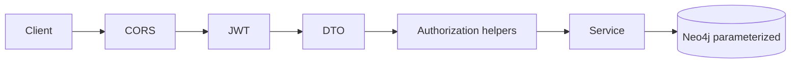

# Security model — TeamMatch

Taxonomy of threats and controls implemented (or planned) per layer.

## 1. IDOR (Insecure Direct Object Reference)

**Threat:** User A mutates or reads resources of user B by guessing IDs.

**Controls:**
- Project-scoped queries (`findProjectForUser`, `isUserInProject`).
- Task workflow: only leaders approve reviews (`TasksService.reviewTask`).
- Team mutations: `authorizeProjectLeader` pattern in `TeamService`.
- Feedback: membership + one `EVALUO` per pair per project.
- Helpers: `backend/src/shared/security/authorization.ts`.

**Verify:** `npm run test:security` and `backend/src/modules/tasks/task.service.test.ts`.

## 2. Authentication & JWT

**Threat:** Token forgery, weak secrets, expired sessions accepted.

**Controls:**
- HS256 with `JWT_SECRET` (≥32 chars in production).
- `JwtAuthMiddleware` reloads user; email must match payload.
- Expired tokens → `TOKEN_EXPIRED` (see `app.supertest.test.ts`).
- Login lockout after `MAX_LOGIN_ATTEMPTS`.

## 3. Injection

### Cypher
- Parameterized queries in repositories (`$projectId`, `$userId`).
- No string concatenation of user input in Cypher.

### Prompt / LLM
- Matchmaking sends structured JSON from graph; optional user instructions in labeled section.
- `shared/security/prompt-injection.ts` sanitization where applied.
- Document size caps for Azure skill extraction.

## 4. File upload

**Controls:** `multerUpload` limits, `file-type` magic bytes, UUID filenames, PDF-only on skill suggest route.

## 5. Rate limiting & abuse

**Controls:** `rateLimit` middleware (auth routes); login attempt service.

**Gap:** Global API rate limit not on all routes — recommend reverse-proxy limits in production.

## 6. Mass assignment

**Controls:** DTO validators (`validateDto`, task/project DTOs) whitelist fields.

## 7. SSRF

**Controls:** `ai-service-url.ts` validates AI service base URL; no user-controlled fetch URLs in backend.

## 8. XSS (frontend)

**Controls:** React escaping; avoid `dangerouslySetInnerHTML`. Sanitize rich text if added later.

## 9. Dependency & supply chain

**Controls:** `npm audit` in CI; Vite kept on patched 6.4.x. Pin lockfiles in repo.

## 10. Neo4j credentials

**Controls:** Non-default password in production env validation; optional `teammatch_app` user — see `neo4j/init/08_app_restricted_user.cypher`.

## Defense in depth diagram

